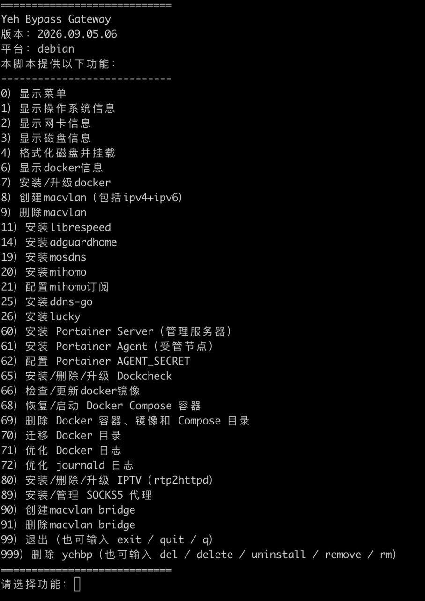

# Yeh Bypass Gateway

自用一键旁路由交互式菜单脚本，提供从 DNS 缓存、域名分流、远程解析、代理接入，到在外回家入口的一整套网络方案。



支持 IPv6，已在群晖 7.3+、飞牛 1.0+、Armbian（Linux 6.1+）上测试通过；并新增 iStoreOS/OpenWrt 后端。

> [!NOTE]
> iStoreOS/OpenWrt 使用 `apk` 或 `opkg`、`procd` 和 `logd`，不是 systemd。该平台支持 Docker 容器安装、macvlan、macvlan bridge 持久化及 Docker `data_root` 迁移；不提供脚本内格式化/挂载磁盘、Docker 安装、journald 优化或 systemd Dockcheck timer；Dockcheck 可选使用 OpenWrt `cron` 每日执行。

## ✅ 适用场景与前置要求

YehBP 主要用于在局域网内搭建轻量旁路网关。核心容器是：

- AdGuardHome：DNS 缓存与管理入口
- MosDNS：域名分流与 FakeIP 解析
- Mihomo：代理入口与 FakeIP 流量承载（Mihomo 换成 Surge 也可）

分流后不需要代理的域名拿到的是真实 DNS，直接走路由器出去，不走旁路；只有需要代理的域名才走旁路。DNS 流量非常小，普通家用场景下，类似 RK3566 + 1GB 内存 + 千兆网口 + Armbian 这一级别的设备即可使用。

需要注意：

- 如果代理流量较大 / 客户端较多，瓶颈在 Mihomo 上，可使用 CPU 性能、网速更高的 x86 安装 Mihomo，或用 macOS 上的 Surge 替代 Mihomo，以获得更好的代理性能。
- FakeIP 旁路需要 DNS 与数据面路由同时可用：仅能解析到 FakeIP 不代表流量能到达代理入口。IPv4/IPv6 的地址规划、Surge/Mihomo 转发和验证见下方「4. FakeIP 旁路与 IPv6 规划」。
> [!WARNING]
> 如果主路由不支持静态路由或 LAN RA 路由宣告，客户端即使能解析到 FakeIP，流量也无法正确到达代理入口，FakeIP 旁路方案不可完整工作。

- 个人目前使用的路由器是 Ubiquiti UDM 系列 / UCG 系列 / UX 系列，已完美支持。

## ✨ 功能特性
- 交互式选择网卡并确认 IP / 网关 / 子网配置
- 创建 Docker macvlan 网络
- 创建宿主机 `macvlan-bridge` 接口用于互通
- 写入并启用 Systemd 服务，确保开机自启
- 安装、升级、删除 `rtp2httpd`，将 IPTV RTP 组播转为 HTTP 单播
- 预定义多个容器 IP：librespeed（.111） AdGuardhome（.114）、MosDNS（.119）、Mihomo（.120）


## ⚙️ 脚本菜单说明

进入菜单前会检查基础依赖；iStoreOS/OpenWrt 优先使用 `apk`，其次使用 `opkg`。依赖安装失败时会退出，请修复软件源或安装依赖后重试。

| 序号 | 功能描述                        |
|----|-----------------------------|
| 0  | 显示菜单                        |
| 1  | 显示操作系统信息                    |
| 2  | 显示网卡信息                      |
| 3  | 显示磁盘信息                      |
| 4  | 格式化磁盘并挂载                    |
| 6  | 显示 Docker 信息                |
| 7  | 安装/升级 Docker              |
| 8  | 创建macvlan（包括ipv4+ipv6）      |
| 9  | 删除 macvlan                  |
| 11 | 安装 LibreSpeed（升级保留 config） |
| 14 | 安装 AdGuardHome（mosdns / 阿里腾讯 / 自定义上游） |
| 19 | 安装 mosdns（可选运营商国内优先上游） |
| 20 | 安装 mihomo（host 模板免 TUN） |
| 21 | 管理 Docker Mihomo 订阅（删除订阅保留当前配置） |
| 22 | 管理原生 Mihomo 订阅 |
| 25 | 安装 ddnsgo                   |
| 26 | 安装 lucky                    |
| 60 | 安装 Portainer Server（管理服务器） |
| 61 | 安装 Portainer Agent（受管节点） |
| 62 | 配置 Portainer AGENT_SECRET      |
| 65 | 安装/设置/删除/升级 Dockcheck       |
| 66 | 检查/更新docker镜像            |
| 68 | 恢复/启动 Docker Compose 容器  |
| 69 | 删除 Docker 容器及可选资源（容器/镜像/目录） |
| 70 | 迁移 Docker 目录               |
| 71 | 优化 Docker 日志               |
| 72 | 优化 journald 日志             |
| 80 | 查看/安装/设置/删除/升级/重启 IPTV（rtp2httpd） |
| 89 | 安装/管理 SOCKS5 代理（含安装镜像） |
| 90 | 创建macvlan bridge            |
| 91 | 删除macvlan bridge            |
| 99 / exit / quit / q | 退出脚本           |
| 999 / del / delete / uninstall / remove / rm | 删除 `yehbp` |

## 🚀 使用方法

### 1. 安装 yehbp

```bash
curl -fsSL https://raw.githubusercontent.com/perryyeh/yehbp/main/install.sh | sudo bash
```

在 iStoreOS/OpenWrt 中，SSH 登录用户通常已是 `root`，系统默认也没有 `sudo`，使用：

```sh
curl -fsSL https://raw.githubusercontent.com/perryyeh/yehbp/main/install.sh | bash
```

YehBP 主程序安装在 `/usr/local/bin/yehbp`。多数 Linux/NAS 与部分 OpenWrt 固件已将 `/usr/local/bin` 加入 root 的 `PATH`，安装后可直接运行：

```bash
sudo yehbp
```

部分 OpenWrt 衍生固件的 root `PATH` 不含 `/usr/local/bin`。安装器会在 `/usr/bin` 已位于 `PATH` 且未存在同名文件时，自动创建兼容软链接 `/usr/bin/yehbp -> /usr/local/bin/yehbp`，因此重新登录后仍可直接运行 `yehbp`。若安装器提示未能创建兼容命令，请使用完整路径：

```sh
/usr/local/bin/yehbp
```

每次运行 `yehbp` 时会检查仓库版本。如果发现新版本，会提示是否升级：

```text
是否现在升级？[y/N]:
```

输入 `y` 才会升级；默认回车或输入 `n` 都不会升级。版本检查只读取仓库里的 `VERSION` 文件；只有远程版本严格高于当前版本才会提示升级，确认升级后才会下载最新脚本并做语法检查，然后覆盖当前 `yehbp` 命令。

### 2. 删除 yehbp

先进入 `yehbp` 交互菜单：

```bash
sudo yehbp
```

然后输入任一删除命令：

```text
999 / del / delete / uninstall / remove / rm
```

脚本会二次确认后删除 `/usr/local/bin/yehbp`、仅当其明确指向该主程序时的兼容软链接 `/usr/bin/yehbp`、同目录 SOCKS5 配置 `/usr/local/bin/yehbpproxy.conf` 和历史备份 `/usr/local/bin/yehbp.bak-*`，不会删除已安装的 Docker 容器、配置目录、macvlan、systemd 服务等。

也可以手动删除：

```bash
sudo rm -f /usr/local/bin/yehbp /usr/local/bin/yehbpproxy.conf /usr/local/bin/yehbp.bak-*
if [ "$(readlink /usr/bin/yehbp 2>/dev/null)" = "/usr/local/bin/yehbp" ]; then
  sudo rm -f /usr/bin/yehbp
fi
```

### 3. 设置旁路由步骤

1. 确认 Docker 容器安装目录；如需新硬盘，先完成格式化和挂载。
2. 确认 Docker 已安装；群晖和飞牛通常已有 Docker，可跳过安装。
3. 群晖的网卡建议先开启 Open vSwitch。
4. **IP 段规划：**
   - **IPv4**
     - 为 macvlan 使用新的、独立的 `/24` 网段，避免与现有 LAN 的 IPRange 或静态地址重叠。
     - 示例：将 LAN 从 `10.0.0.1/24` 放宽为网关 `10.0.0.1`、Subnet `10.0.0.0/23`。
     - DHCP IPRange 仍保持 `10.0.0.2–10.0.0.255`；为 YehBP/Docker macvlan 设置相同的 Subnet `10.0.0.0/23` 与独立的 IPRange `10.0.1.0/24`。
   - **IPv6 ULA**
     - 创建时会提供四个明确选项：`1` 使用所选网卡读取到的 IPv6 默认网关和 CIDR（读取失败时不可选择）；`2` 按 IPv4 网关推导 ULA `/64`（[规则与原因](#ula-derivation)）；`3` 手动输入 IPv6 网关、CIDR 与 range；`4` 不启用 macvlan IPv6。
     - 回车默认选择 `2`，`n` 等同于 `4`。VLAN 子接口无完整 IPv6 信息时，选项 `1` 会回退检查物理 parent。
5. 选择网卡创建 macvlan；群晖建议选择 `ovs` 开头网卡。
6. 没有 Surge / OpenWrt 作为代理时，可安装 Mihomo 替代；Mihomo 需开启 TUN 模式并配置好上游代理。
7. 安装 MosDNS；选择 Surge 作为上游时 DNS 写 `198.18.0.2`，选择 Mihomo 作为上游时 DNS 写 Mihomo 的 局域网IP。可选启用运营商 DNS 作为国内优先上游（默认关闭），输入一个或多个 IPv4 地址，以空格分隔。模板预置 `192.0.2.1` 占位上游和两套国内转发组；启用时替换占位地址、将运营商回退阈值设为 25 ms 并切换国内入口，不启用则保留占位但不调用，继续使用原阿里/腾讯组合；启用后运营商使用普通 UDP 查询，运营商与原阿里/腾讯组合同时开始查询；优先采用运营商结果，失败、无应答或超过 25 ms 时可采用备用结果。原 ali/tencent 定义、组合参数及分流规则不变，不是三家竞速；正常 DNS 应答（包括 NXDOMAIN）不会因此自动回退。不要输入会转发回 AdGuard Home / MosDNS 的路由器地址。
8. 安装 AdGuardHome：默认选择 `1` 配合 MosDNS，沿用原地址配置流程；也可选择 `2` 独立使用阿里 `223.5.5.5` + 腾讯 `119.29.29.29`（普通 UDP），或 `3` 输入一个或多个自定义上游（空格分隔，支持 IP、IP:端口、DoH/DoT）。选项 `2`、`3` 不询问 MosDNS 地址，仅替换完整的 `upstream_dns` 列表；备用 DNS、bootstrap、上游模式、缓存等保持模板原样，安装后请在管理页面自行调整。不要输入会转发回本 AdGuardHome 的上游，以免形成解析循环。
9. 最后创建 macvlan bridge，解决宿主机和容器之间的互通。bridge IPv4 使用 macvlan IPv4 IPRange 的最后一个可用地址；bridge IPv6 使用 Docker IPv6 IPRange 的最后一个地址，宿主机也对该相同 IPv6 IPRange 写入 bridge 路由。手动输入的 IPv6 CIDR/IPRange/Gateway 优先；如 IPv6 IPRange 与 parent 接口现有 RA/on-link 前缀重叠，应确认该路由设计符合预期。
10. 按下方「[4. FakeIP 旁路与 IPv6 规划](#fakeip-routing)」完成 Surge 或 Mihomo 的 FakeIP 数据面转发与验证。
11. 在路由器把 AdGuardHome 的 IP 设置为局域网 DNS。

#### 安装时的网络模式选择

菜单 `20`、`25`、`26` 安装容器时会询问网络模式。选择不会自动由“回家”场景推断，应按实际用途确认：

| 容器 / 菜单 | 默认模式 | `host` | `macvlan` |
|---|---|---|---|
| Mihomo / `20` | `macvlan` | 使用宿主机网络，适合提供在外回家入口；会占用宿主机 `7890`、`7891`、`7892`、`9090` 等端口。 | 独立 LAN IP/MAC，适合旁路由出站代理。 |
| ddns-go / `25` | `host` | 直接使用宿主机的 IPv4/IPv6，适合双栈 DDNS；会占用宿主机 `9876` 端口。 | 独立 LAN IP/MAC，适合仅 IPv4 的环境。 |
| Lucky / `26` | `host` | 直接使用宿主机网络，适合 IPv4 + IPv6；会占用宿主机 `16601` 端口。 | 独立 LAN IP/MAC，适合仅 IPv4 的环境。 |

同一宿主机需要同时运行不同用途的实例时，为每个实例指定不同的容器/目录名称，并确认其端口不会冲突。Mihomo 的 `host` 上游模板不再映射 `/dev/net/tun`（其 `tun.enable` 默认为 `false`）。`macvlan` 上游模板保持原样；宿主机无 TUN 时，YehBP 仅从安装时生成的 `compose.yaml` 移除设备映射，不修改配置文件中的 `tun.enable: true`，因此 Mihomo 进程可能仍无法运行，Fake-IP 旁路也不能据此视为可用；若新容器已创建但启动失败，YehBP 会保留新容器与旧容器备份供排查（旧容器此时处于停止状态）；需要后续补齐 TUN 或自行调整运行配置。

安装 Mihomo 时，YehBP 会按所选模式读取 `config.host.yaml` 或 `config.macvlan.yaml` 的 `external-ui` 与 `external-ui-url`，下载 tar.gz 格式的最新 UI，校验归档结构和 `index.html` 后原子替换到该 `external-ui` 目录；UI 下载或校验失败会在启动容器前取消安装。

<a id="fakeip-routing"></a>

### 4. FakeIP 旁路与 IPv6 规划

FakeIP 的 DNS 返回地址只是代理流量的目标地址；客户端、路由器或宿主机还必须把该地址段的数据流送到 Surge / Mihomo。验证时始终使用当前 DNS 实际返回的 FakeIP，不要写死某次解析结果。

<a id="ula-derivation"></a>

#### 4.1 ULA：YehBP 为什么这样推导

YehBP 默认把 RFC1918 IPv4 网段映射为独立 ULA `/64`：

| IPv4 网段 | 默认 ULA `/64` |
|---|---|
| `10.A.B.0/24` | `fd00:10:A:B::/64` |
| `172.A.B.0/24` | `fd00:172:A:B::/64` |
| `192.168.B.0/24` | `fd00:192:168:B::/64` |

这样可完整保留 IPv4 前三个 octet 的可读性，例如 `10.88.99.0/24` 对应 `fd00:10:88:99::/64`；每个 macvlan 网络也能拥有独立 ULA `/64`，供容器、bridge 和代理下一跳使用，而不依赖可能变化的公网 IPv6 GUA。IPv6 hextet 按十六进制解析；此处使用 IPv4 十进制文本作为可读标签，不是二进制位级映射。

选择自动 ULA 模式时，YehBP 还会按 IPv4 `IPRange` 的第三段建议 IPv6 `IPRange`：例如 IPv4 gateway 为 `10.86.8.1`、IPv4 `IPRange` 为 `10.86.9.0/24` 时，默认 ULA Subnet 为 `fd00:10:86:8::/64`，默认 IPv6 `IPRange` 为 `fd00:10:86:8::9:0/112`。这是便于兼容 `::第三段:最后段` 静态容器地址的推导建议；IPv4 `/25` 或更窄时仍使用对应第三段的 `/112`，不改变现有静态 IPv6 地址格式。手动输入 IPv6 `IPRange` 始终优先。

这只是便捷、确定性的映射，不是 RFC4193 随机 Global ID。多站点、跨网络互联或长期正式部署时，建议自行规划 RFC4193 ULA，并在创建 macvlan 时输入完整 IPv6 CIDR。

> Fake-IP 地址池与 LAN ULA 是不同概念：LAN ULA 用于稳定的局域网下一跳；Fake-IP 是 DNS 为代理域名返回的目标地址。

> [!WARNING]
> 默认使用 IPv4 计算容器的 MAC 地址，格式类似 `02:*:86`。
>
> 安装 macvlan bridge 出错时请回滚，以免流量死循环、无法进入设备而需要重新刷机。
>
> 如果安装 macvlan bridge 后将 FakeIP 路由指向本机 Mihomo，且 ddns-go 容器使用 `host` 网络模式，请注释其配置中的 `httpinterface: end0`（或实际物理网口名）；否则可能导致公网 IPv4 获取或 DNS 记录提交异常。

#### 4.2 转发到 macOS Surge

##### Fake IPv4

| 项目 | 地址 / 前缀 |
|---|---|
| Surge VIF 网关 | `198.18.0.1` |
| Fake DNS IPv4 | `198.18.0.2` |
| Fake IPv4 池 | `198.18.0.0/15` |

主路由必须添加静态路由：`198.18.0.0/15` 的下一跳为运行 Surge 的 Mac 局域网 IPv4，例：如果surge所在的mac局域网ip是10.0.0.120，那么在路由器上静态路由198.18.0.0/15下一跳为10.0.0.120。

##### Fake IPv6：Surge VIF 与 LAN RIO

Surge 使用 VIF 承载 FakeIP，必须设置 `ipv6-vif = always`。macOS 首先要解决 IPv6 承载：将客户端发往 Fake IPv6 的流量转发到 Surge 所在的 `tun`。Mac 须开启 `net.inet6.ip6.forwarding=1`；Mac 开机、Surge 重启或主网卡变化后，需要确认当前 VIF、本机路由和 LAN RA 仍保持一致。

Fake IPv6 的下一跳有两种方案：

1. **经主路由转发到 macOS Surge**：在主路由添加 Fake IPv6 前缀到 Mihomo/Surge LAN IPv6 下一跳的静态路由。旧版实际 Fake IPv6 池 `fd00:6152:0:9::/64` 属于 ULA，通常会被路由器按内部目的前缀处理并默认放行。新版 `2001:2:0:6152::/64` 不属于路由器的本地网段；在 UniFi 上，即使已静态路由至 Mihomo/Surge，也可能被归入 LAN → WAN/External。若回程绕过路由器，后续 TCP 包会被 `INVALID DROP` 丢弃。因此须添加一条位于 `INVALID DROP` 之前的高优先级 IPv6 Allow 规则，放行 LAN 到 `2001:2:0:6152::/64` 的流量。不要把该前缀配置为路由器实际承载的 LAN 接口网段，以免与静态路由和 RA 行为冲突。
2. **由 macOS Surge 主机直接宣告 RA**：macOS 通过 RA 的 Route Information Option（RIO）向 LAN 宣告 Fake IPv6 前缀；客户端直接将该前缀的流量交给 Mac，再由 Mac 转发到 Surge `tun`。这会绕过主路由的上述 IPv6 状态防火墙路径。

###### Surge 旧版与新版 Fake IPv6 对照（新版 6.8.0，2026.08.06 发布）

| 项目 | 旧版 Surge | 新版 Surge |
|---|---|---|
| Surge VIF 网关 | `fd00:6152::1` | `2001:2:0:6152::1` |
| Fake DNS IPv6 | `fd00:6152::2` | `2001:2:0:6152::2` |
| 实际 Fake IPv6 池 | `fd00:6152:0:9::/64` | `2001:2:0:6152:0:9::/96` |
| macmini 本机路由 / LAN RIO | `fd00:6152::1/127`、`fd00:6152:0:9::/64` | `2001:2:0:6152::/64` |

###### macOS Surge RA reference

脱敏参考实现位于 [`assets/macmini/`](assets/macmini/)，文件与 macOS 安装位置对应：

| 仓库文件 | macOS 目标位置 | 职责 |
|---|---|---|
| `assets/macmini/surge-ipv6-router` | `/usr/local/sbin/surge-ipv6-router` | 找到 Surge `utun`、将 Fake IPv6 `/64` 路由到 VIF、生成配置并管理 `rtadvd`。 |
| `assets/macmini/surge-fake-rtadvd.conf` | `/usr/local/etc/surge-fake-rtadvd.conf` | 参考模板；运行时由 helper 生成，向 LAN 发布 RIO。 |
| `assets/macmini/local.surge-ipv6-router.plist` | `/Library/LaunchDaemons/local.surge-ipv6-router.plist` | 以 launchd 在开机和异常退出后启动 helper。 |

参考脚本不含特定家庭 LAN IP、ULA 或 MAC 地址；需要 macOS 自带的 `scutil` 与 Python 3。部署前编辑 `assets/macmini/local.surge-ipv6-router.plist`：

- helper 每 5 秒读取 macOS SystemConfiguration 的 ServiceOrder，选择首个有 IPv4 Router 状态的非 VPN/bridge 物理服务；不要用 Surge 接管后的默认路由判断接口。
- `__LAN_ULA_ADDR__` 是可选稳定 ULA 下一跳；若需要路由器静态路由兜底，替换为该 LAN ULA `/64` 内一个未使用地址；否则保持占位符不变，helper 不会添加 ULA alias。接口切换时，该 alias 会从旧物理接口迁移到当前承载接口。

运行时 helper 用当前选中的接口生成 `surge-fake-rtadvd.conf`；仓库中的同名文件是带 `__LAN_INTERFACE__` 占位符的参考模板。

> [!WARNING]
> 注意 Surge 版本区别：YehBP 当前代码只处理新版 Surge 的 `2001:2:0:6152` 地址体系。旧版 Surge 用户需按上表自行对照修改 VIF 路由、LAN RIO 与相关 Fake-IP 配置。

如果上述 Surge 链路未验证完成，安装 mosdns 时不要开启 fake IPv6 解析。

#### 4.3 转发到 Mihomo

| 流量 | 路由前缀 | 下一跳 |
|---|---|---|
| Fake IPv4 | `198.18.0.0/15` | Mihomo 的 LAN IPv4 |
| Fake IPv6 | 字段 `dns.fake-ip-range6`，默认值 `2001:2:0:6152:0:9::/96`；路由器与 YehBP host bridge 均应使用该实际精确前缀。如有变更，需要重新创建宿主机到容器的 bridge 互通。 | Mihomo 的 LAN ULA IPv6 |

Mihomo 也使用 FakeIP，但与 Surge 不同：它没有 Surge VIF 的 `::1` 网关和 `::2` Fake DNS 地址，Fake-IP 前缀由 Mihomo 配置直接决定。主路由直接设置 Fake IPv4 和 Fake IPv6 的静态路由：IPv4 下一跳为 Mihomo 的 LAN IPv4，IPv6 下一跳为 Mihomo 的 LAN ULA IPv6。

YehBP 创建 macvlan bridge 时，如探测到 Mihomo，会询问是否同时写入宿主机直达 Mihomo 的 FakeIP route；这只优化宿主机访问，不替代 LAN 或 macvlan 客户端所需的路由。

#### 4.4 macvlan 容器：接受 Surge RA 的 Fake IPv6 路由

使用 Docker `macvlan` 的容器，在通过 Surge RA 获得非默认 Fake IPv6 路由时，需要显式接受该 RIO。否则容器即使能解析出 Fake IPv6，也可能不会安装指向 Surge 的专用路由，而是错误走默认 IPv6 网关，导致 HTTPS 超时。

在每个需要访问 Fake IPv6 的服务的 `macvlan` network endpoint 中加入：

```yaml
services:
  app:
    networks:
      macvlan:
        ipv4_address: ${ipv4}
        ipv6_address: ${ipv6}
        driver_opts:
          com.docker.network.endpoint.sysctls: net.ipv6.conf.IFNAME.accept_ra_rt_info_max_plen=128
```

该项是服务级 `networks.macvlan` 配置，不是顶层 `networks` 配置。容器重建后，对当前 DNS 返回的 Fake IPv6 执行：

```bash
ip -6 route get <当前 DNS 返回的 Fake IPv6>
```

正常结果应命中 Surge RA 宣告的专用下一跳，而不是仅依赖默认 IPv6 网关。

### 5. IPv4 + IPv6 回家
⚠️ 入站协议尽量避免udp。下列方案依赖mihomo入站，请先安装mihomo并配置好入站端口。

| 场景 | 公网ipv4 | 公网ipv6 | 容器可得ipv6 | 入站方式                                                                                           
|----|---|---|----------|------------------------------------------------------------------------------------------------|
| 1  | ✅ | ✅ | ✅        | 输入25，安装和mihomo共用ip【局域网ipv4+公网ipv6】的ddnsgo来更新ipv4+ipv6。ipv4在路由器上端口转发到mihomo，ipv6在路由器上开放ipv6端口入站 |
| 2  | ❌ | ✅ | ✅        | 输入25，安装和mihomo共用ip【局域网ipv6】的ddnsgo来更新ipv6。 IPv4考虑relay(比如lucky), ipv6在路由器上开放ipv6端口入站           |
| 3  | ✅ | ❌ | ❌        | 随意ddns后，路由器加端口转发，仅IPv4。                                                                        |
| 4  | ❌ | ✅ | ❌        | IPv6入站可做但不推荐，视作行5考虑                                                                            |
| 5  | ❌ | ❌ | ❌        | 选relay/tunnel方案，比如cloudflare tunnel，frp，tailscale什么的                                           |

### 6. 其他

#### 6.1 管理 Docker Mihomo 订阅（菜单 21）

用于 YehBP 安装的 Docker 或宿主机 Mihomo（macvlan 或 host），不是 OpenWrt 自己安装的 Mihomo。先选择实例，再添加/修改订阅、立即更新、删除订阅或查看日志。

添加时输入完整订阅地址、更新间隔（小时，`0` 表示不自动更新），并选择按当前模式模板调整订阅，或原样使用。更新成功后只重新加载 Mihomo，不重启容器。删除订阅会取消自动更新，但保留当前配置。

#### 6.2 管理原生 Mihomo 订阅（菜单 22）

仅用于 OpenWrt 自己安装的 Mihomo，不是 YehBP 安装的实例。可添加/修改完整配置订阅地址、立即更新、删除订阅或查看状态。

立即更新会下载并检查配置；内容有变化时替换配置并重启 Mihomo，失败则保留或恢复更新前的配置。内容没变时不替换、不重启。删除订阅只去掉订阅和更新记录，不改当前配置，也不重启 Mihomo。

#### 6.3 配置 Portainer AGENT_SECRET（菜单 62）

菜单 `62` 列出本机的 Portainer Server 和 Agent，每次选择一个。可选不设置、生成随机值，或输入已有值。同一套 Portainer 管理的 Server 和 Agent 必须使用相同的值；生成随机值后请保存，并在其他相关容器上配置同一个值。

设置后会重建所选容器使它生效，失败时恢复这次修改前的配置。只支持 YehBP 能识别的本地 Compose 部署。

#### 6.4 安装/设置/删除/升级 Dockcheck（菜单 65）

菜单 `65` 可查看状态、安装/设置、删除或升级 Dockcheck。安装时选择一个 dockerapps 目录，再设置新镜像延迟几天更新、更新后是否删除无用旧镜像，以及是否每天自动更新；启用时还可设置每天的检查时间，默认 `05:00`。Linux/NAS 使用 systemd 定时，OpenWrt 使用系统定时任务；删除 Dockcheck 时会一并取消。

只有安装/设置时才会按需补装缺少的系统组件。补装失败会停止，不会覆盖已有设置。查看状态或用菜单 `66` 检查镜像时不会安装软件包。

#### 6.5 检查/更新 Docker 镜像（菜单 66）

需先用菜单 `65` 安装 Dockcheck。菜单 `66` 可选：检查并更新 Compose 容器、只检查全部容器，或检查/拉取非 Compose 容器的镜像。更新 Compose 容器会拉取新镜像并重建，服务可能短暂中断；非 Compose 容器只拉取镜像，不重建容器。此功能不使用菜单 `89` 的代理。

#### 6.6 恢复/启动 Docker Compose 容器（菜单 68）

菜单 `68` 先列出正在运行、且能找到 Compose 目录的容器。选中后，如果该项目已有容器在运行，会询问是否按当前配置强制重建全部服务；如果没有运行中的容器，则直接创建或启动。

选 `m` 可改从 dockerapps 目录选择，只列出该目录下一层的 Compose 项目。不会构建镜像，也不会删除项目里多余的容器。

#### 6.7 删除 Docker 容器、镜像和 Compose 目录（菜单 69）

菜单 `69` 列出所有容器（含已停止的）。选中后选择删除范围：只删容器；删除容器，并在没有其他容器使用时删除镜像；或再连同删除该容器的 Compose 目录。确认前会说明实际会删除什么。镜像仍被其他容器使用时会保留，并列出这些容器。没有 Compose 目录、或目录位置无法安全确认时，不会删除主机目录，也不会删除 Docker 数据卷。

#### 6.8 IPTV（rtp2httpd，菜单 80）

支持带 NetworkManager 和 systemd 的 Linux/NAS，不支持 OpenWrt。菜单 80 可查看已安装信息、安装/设置、删除、升级或重启。

安装/设置时，选已有实例只改其中一项；新建则按提示配置网卡、VLAN、监听地址和端口。可在同一处设置组播直播、FCC 快速换台和 RTSP 回放。新建和再次进入已有实例，都会给该实例拥有的 IPTV 连接显式设置 `ipv4.ignore-auto-dns=yes` 和 `ipv6.ignore-auto-dns=yes`，不改变已有 IPv4/IPv6 地址方法。DHCP 继续提供地址和专用路由；已有实例不会因此重建网络。

获取播放列表参见 [IPTV 频道抓取参考](assets/iptv/README.md)。

#### 6.9 SOCKS5 代理（菜单 89）

菜单 `89` 可添加、查看或删除一个无认证 SOCKS5 代理，输入 `IP或域名:端口`。用于 YehBP 检查更新、功能下载和支持的应用镜像下载；镜像下载仅支持公开 Docker Hub，不适用于菜单 `66` / Dockcheck。已配置代理但没有 `curl` 时，这些下载会取消，不会改为直连。

## 📦 依赖

| 类型 | 依赖 |
|---|---|
| 基础脚本依赖 | `ipcalc`, `curl`, `jq`, `tar` |
| Docker 功能依赖 | `docker`, `docker compose` |
| 自动更新依赖 | `dockcheck`, `flock`, `python3`, `systemctl`, `regctl` |

不同 NAS / Linux 发行版自带命令差异较大，安装前建议先确认基础依赖和 Docker Compose 是否可用。若 Debian/类 Debian NAS 的 APT 被与 YehBP 无关的残缺软件包阻塞，YehBP 会在常规安装失败后：为 `jq` 下载并校验官方独立二进制、为 `ipcalc` 仅下载并安装该单独 `.deb`；不会执行 `apt --fix-broken install`。

- https://github.com/perryyeh/librespeed
- https://github.com/perryyeh/adguardhome
- https://github.com/perryyeh/mosdns
- https://github.com/perryyeh/mihomo
- https://github.com/perryyeh/ddnsgo
- https://github.com/perryyeh/lucky

## 🧪 开发测试

长期回归测试随仓库维护在 [`tests/`](tests/README.md)。在仓库根目录运行 `python3 -m unittest discover -s tests -v`；依赖、隔离方式、跳过条件和真实集成边界见测试说明。

## 📚 参考文献：
- https://github.com/IrineSistiana/mosdns
- https://github.com/AdguardTeam/AdGuardHome
- https://github.com/MetaCubeX/mihomo
- https://github.com/mag37/dockcheck
- https://github.com/stackia/rtp2httpd
- https://github.com/pcg562240/pcg-iptv

## 📜 License
MIT License © 2026
